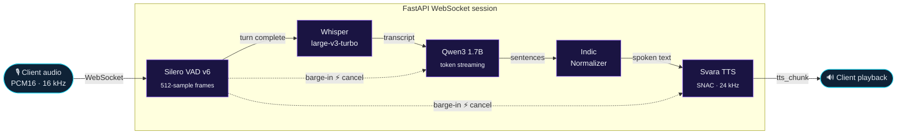
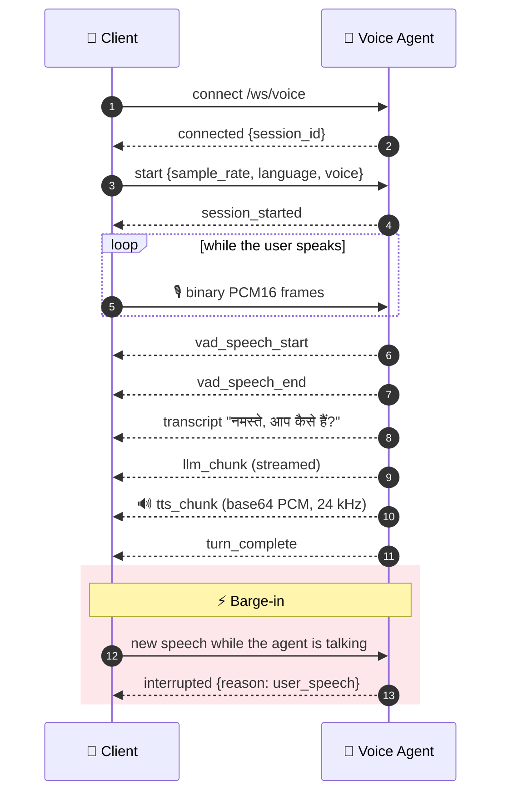

<div align="center">



<picture>
  <source media="(prefers-color-scheme: dark)" srcset="assets/typing-dark.svg">
  
</picture>

<p>
  
  
  
  
</p>
<p>
  
  
  
  <a href="LICENSE"></a>
</p>

<p>
  <a href="#-quick-start"><b>Quick start</b></a> ·
  <a href="#-how-it-works"><b>How it works</b></a> ·
  <a href="#-websocket-protocol"><b>Protocol</b></a> ·
  <a href="#%EF%B8%8F-deploy-on-google-cloud"><b>Deploy</b></a> ·
  <a href="#%EF%B8%8F-configuration"><b>Config</b></a> ·
  <a href="docs/"><b>Docs</b></a>
</p>

</div>

---

## 🎙️ About

**Speech-to-Speech Voice Agent** is a real-time, full-duplex conversational voice assistant built for **Indian languages**. You talk; it listens, understands, thinks, and talks back, and you can **interrupt it mid-sentence** just like a real conversation.

Everything runs as one streaming pipeline behind a single WebSocket:

> **Silero VAD** → **Whisper large-v3-turbo** → **Qwen3 1.7B** → **Indic text normalization** → **Svara TTS**

It's tuned to run **entirely locally on an 8 GB Apple Silicon Mac** (via MLX), and scales up to a **single NVIDIA L4 GPU on Google Cloud** with a target of **~0.8–1.2 s** from the end of your speech to the first audio reply.

<div align="center">

🎧 **[Listen to a real reply generated end-to-end on an M2 Pro](voice_agent/server/static/verified-svara-response.wav)**

</div>

## ✨ Features

<table>
<tr>
<td width="50%" valign="top">

### 🗣️ Natural conversation
- **Full-duplex streaming:** audio in and out at the same time
- **Barge-in:** start speaking and the agent stops instantly, cancelling the LLM and TTS
- **Low first-audio latency:** TTS starts on the first sentence while the LLM is still generating

</td>
<td width="50%" valign="top">

### 🇮🇳 Built for India
- **Multilingual STT:** Hindi, Bengali, Marathi, Tamil, Telugu, English and more
- **38 Svara voice profiles** across **19 Indian languages**
- **Indic text normalization:** `₹500` → *"पांच सौ रुपये"* before speech synthesis

</td>
</tr>
<tr>
<td width="50%" valign="top">

### 💻 Runs on a laptop
- **MLX backend** for Apple Silicon: quantized Whisper, Qwen3 and Svara stay resident (~3.7 GB)
- Memory-aware model lifecycle for **8 GB unified memory**
- **Mock adapters** to develop with zero model downloads

</td>
<td width="50%" valign="top">

### 🚀 Production-ready path
- **vLLM** serving Qwen3 + Svara on one **NVIDIA L4**
- **faster-whisper** (CTranslate2) STT on CUDA
- **Docker Compose + Caddy** with automatic HTTPS, plus one-command GCP scripts

</td>
</tr>
</table>

## 🧠 How it works

<div align="center">

</div>

<br/>



| Stage | Model | Apple Silicon (local) | NVIDIA GPU (cloud) |
| :-- | :-- | :-- | :-- |
| **Voice activity** | Silero VAD v6 (TorchScript) | CPU · < 10 MB · ~1 ms / frame | CPU |
| **Speech-to-text** | Whisper `large-v3-turbo` (809M) | MLX 8-bit, or PyTorch on MPS | faster-whisper fp16 |
| **Language model** | Qwen3 1.7B | MLX 4-bit, or PyTorch on MPS | vLLM (OpenAI-compatible API) |
| **Normalization** | Indic WFST / rule-based fallback | Rule-based (Pynini optional) | Rule-based / WFST |
| **Text-to-speech** | Svara TTS v1 + SNAC codec | MLX 4-bit (`mlx-audio`), `say` fallback | Svara on vLLM |

> [!TIP]
> Want the deep dive? See [`docs/ARCHITECTURE.md`](docs/ARCHITECTURE.md) for the concurrency model, bounded queues, cancellation and the 8 GB memory budget.

## ⚡ Quick start

### Prerequisites
- **macOS on Apple Silicon** (M1/M2/M3/M4) *or* **Linux with an NVIDIA GPU**
- **Python 3.11 or 3.12**
- [`uv`](https://github.com/astral-sh/uv) (recommended) or `pip`

### 1 · Clone and install

```bash
git clone https://github.com/SURISURENDRA18/speech-to-speech-voice-agent-.git
cd speech-to-speech-voice-agent-

uv venv .venv --python 3.11
source .venv/bin/activate

uv pip install \
  torch torchvision torchaudio transformers accelerate \
  fastapi "uvicorn[standard]" pydantic pydantic-settings websockets \
  numpy soundfile pyyaml httpx aiohttp sounddevice \
  pytest pytest-asyncio ruff

# Apple Silicon: quantized Whisper + Qwen3 + Svara via MLX
uv pip install "mlx-audio[stt,tts,llm]"
```

### 2 · Configure

```bash
cp .env.example .env    # then tweak language, voice, models…
```

### 3 · Run

```bash
python main.py
```

```text
======================================================================
 Speech-to-Speech Voice Agent
 Binding to: http://0.0.0.0:8000
 WebSocket endpoint: ws://0.0.0.0:8000/ws/voice
 ...
======================================================================
```

Open **http://localhost:8000**, allow the microphone, and start talking. 🎉

> [!NOTE]
> The first run downloads model weights from Hugging Face (several GB), so the first reply takes a while. Subsequent turns are much faster.

<details>
<summary><b>🧪 Run without downloading models (mock modes)</b></summary>
<br/>

| Command | What you get |
| :-- | :-- |
| `python main.py --mock-stt --mock-llm` | Canned transcript + reply, **real spoken audio** (MLX Svara or macOS `say`) |
| `python main.py --mock-all` | Everything mocked; TTS is a synthetic test tone |
| `python main.py --mock-llm` | Real speech recognition, canned reply |
| `python main.py --reload` | Auto-reload for development |

</details>

<details>
<summary><b>⌨️ Terminal client (no browser)</b></summary>
<br/>

```bash
python terminal_client.py                     # talk through your mic
python terminal_client.py --wav sample.wav    # send a WAV file instead
python terminal_client.py --full-duplex       # keep the mic open while the agent speaks (use headphones)
```

</details>

## 🔌 API endpoints

| Method | Endpoint | Description |
| :-- | :-- | :-- |
| `GET` | `/` | Built-in web client with mic capture and streaming playback |
| `WS` | `/ws/voice` | Full-duplex voice session |
| `GET` | `/health` | Component health and which backend each stage is using |
| `GET` | `/info` | Hardware and model info (MPS / CUDA, device names) |
| `GET` | `/v1/voices` | Available Svara voice profiles |
| `GET` | `/v1/client-config` | Client playback defaults |

## 🔁 WebSocket protocol

Audio goes **up** as binary PCM16 frames; events and synthesized audio come **down** as JSON.



<details>
<summary><b>📦 Example messages</b></summary>
<br/>

```jsonc
// client → server
{ "type": "start", "config": { "sample_rate": 16000, "language": "hi", "voice": "hi_female" } }

// server → client
{ "type": "transcript", "text": "नमस्ते, आप कैसे हैं?", "language": "hi", "is_final": true }
{ "type": "tts_chunk", "audio": "<base64 pcm16>", "sample_rate": 24000, "channels": 1, "format": "pcm16", "is_last": false }
{ "type": "interrupted", "reason": "user_speech" }
```

Full spec: [`docs/PROTOCOL.md`](docs/PROTOCOL.md)

</details>

## ☁️ Deploy on Google Cloud

One `g2-standard-8` VM with a single **NVIDIA L4** (Mumbai, `asia-south1`) runs four containers:

| Container | Role | GPU memory |
| :-- | :-- | :-- |
| `svara` | Svara TTS on vLLM, streaming PCM | ~10 GB |
| `qwen` | Qwen3 1.7B on vLLM (OpenAI-compatible) | ~6 GB |
| `agent` | This app: VAD, faster-whisper, WebSocket sessions | ~2.5 GB |
| `caddy` | Automatic HTTPS (browsers require it for the microphone) | – |

```bash
bash deploy/gcp/create_vm.sh     # VM + static IP + firewall  (SPOT=true for ~60–70% cheaper)
bash deploy/gcp/deploy.sh        # upload, build, docker compose up
```

**Latency budget for one turn:**

```text
VAD silence ~300 ms ▸ Whisper 150–300 ms ▸ Qwen first sentence 100–200 ms ▸ Svara first chunk 150–300 ms
└───────────────────────────── target ≈ 0.8 – 1.2 s to first audio ─────────────────────────────┘
```

> [!WARNING]
> A GPU VM bills **while it is running**, whether or not anyone is talking to it. Stop it with `gcloud compute instances stop voice-agent-gpu --zone asia-south1-a`. Full guide, cost notes and troubleshooting: [`docs/DEPLOY_GCP.md`](docs/DEPLOY_GCP.md).

## ⚙️ Configuration

All settings live in `.env` (see [`.env.example`](.env.example)) and are loaded with `pydantic-settings`.

| Variable | Default | Description |
| :-- | :-- | :-- |
| `USE_MLX` | `true` | Use quantized MLX models on Apple Silicon |
| `WHISPER_LANGUAGE` | `hi` | Fix the STT language (skips detection, faster) |
| `SVARA_VOICE` | `hi_female` | Default voice profile |
| `VAD_MIN_SILENCE_DURATION_MS` | `300` | Silence that ends a turn (lower = snappier, may cut slow speakers) |
| `OVERLAP_LLM_TTS` | `true` | Speak sentence 1 while the LLM keeps generating |
| `LLM_API_URL` | – | Point at a vLLM / OpenAI-compatible server instead of a local LLM |
| `SVARA_API_URL` | – | Point at a remote Svara GPU server |
| `CLIENT_PLAYBACK_MODE` | `auto` | `auto` · `smooth` · `fast` |

<details>
<summary><b>All options</b></summary>
<br/>

See [`voice_agent/config.py`](voice_agent/config.py) for every setting, including audio sample rates, queue sizes, VAD thresholds, model IDs, dtypes, generation length/temperature, the system prompt, and normalization options.

</details>

## 🗂️ Project structure

```text
.
├── main.py                    # CLI entry point (uvicorn + mock flags)
├── terminal_client.py         # mic / WAV client for the WebSocket API
├── voice_agent/
│   ├── config.py              # pydantic-settings configuration
│   ├── audio.py               # PCM conversion & resampling
│   ├── pipeline/session.py    # per-connection pipeline, queues, barge-in
│   ├── vad/                   # Silero VAD streaming detector
│   ├── stt/                   # Whisper: MLX · transformers · faster-whisper · mock
│   ├── llm/                   # Qwen3: MLX · transformers · OpenAI-compatible · mock
│   ├── normalization/         # Indic text normalization (WFST + rule-based)
│   ├── tts/                   # Svara TTS: MLX · remote API · mock
│   └── server/                # FastAPI app, WebSocket handler, web client
├── deploy/gcp/                # Dockerfiles, compose, Caddy, VM scripts
├── docs/                      # architecture, protocol, setup & deploy guides
└── tests/                     # unit, integration & real-hardware smoke tests
```

## 🧪 Testing

```bash
python -m pytest tests/ -v          # unit + integration (+ real smoke tests when models are present)
python -m ruff check voice_agent/ tests/
```

## 📚 Documentation

| Guide | What's inside |
| :-- | :-- |
| [Architecture](docs/ARCHITECTURE.md) | Pipeline stages, concurrency, cancellation, memory budget |
| [WebSocket protocol](docs/PROTOCOL.md) | Every message type with examples |
| [macOS setup](docs/SETUP_MACOS.md) | Apple Silicon install, MLX, Pynini notes |
| [Google Cloud deploy](docs/DEPLOY_GCP.md) | L4 VM, Docker Compose, HTTPS, tuning, costs |
| [Compatibility report](docs/COMPATIBILITY_REPORT.md) | Verified results on real hardware |

## 🙏 Acknowledgements

This project stands on the shoulders of excellent open-source work:

- [**Silero VAD**](https://github.com/snakers4/silero-vad): voice activity detection
- [**OpenAI Whisper**](https://github.com/openai/whisper): multilingual speech recognition
- [**Qwen3**](https://huggingface.co/Qwen/Qwen3-1.7B): conversational language model
- [**Svara TTS**](https://github.com/Kenpath/svara-tts-inference): expressive Indic text-to-speech
- [**MLX**](https://github.com/ml-explore/mlx) & [**mlx-audio**](https://github.com/Blaizzy/mlx-audio): fast inference on Apple Silicon
- [**vLLM**](https://github.com/vllm-project/vllm): high-throughput GPU serving
- [**huggingface/speech-to-speech**](https://github.com/huggingface/speech-to-speech): architectural inspiration

## 🤝 Contributing

Contributions, issues and feature requests are welcome!

1. Fork the repo and create a branch: `git checkout -b feature/amazing-idea`
2. Make sure `pytest` and `ruff check` pass
3. Open a pull request describing what you changed and why

## 📄 License

Distributed under the **Apache License 2.0**. See [`LICENSE`](LICENSE) and [`NOTICE`](NOTICE) for details.
Model weights downloaded at runtime are governed by their own licenses.

<div align="center">
<br/>


<sub>Built with ❤️ for India's many voices · <a href="https://github.com/SURISURENDRA18">@SURISURENDRA18</a></sub>

</div>
